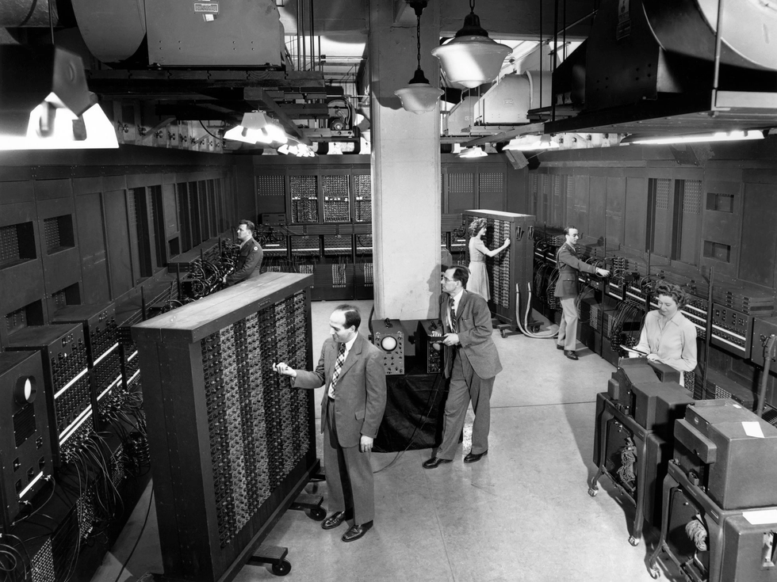
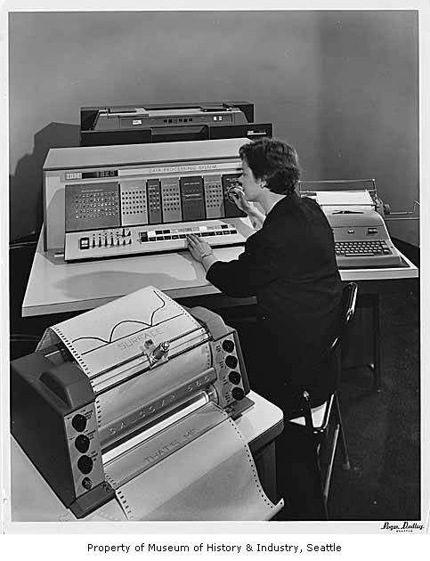
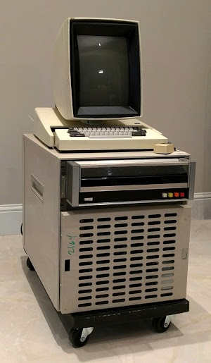
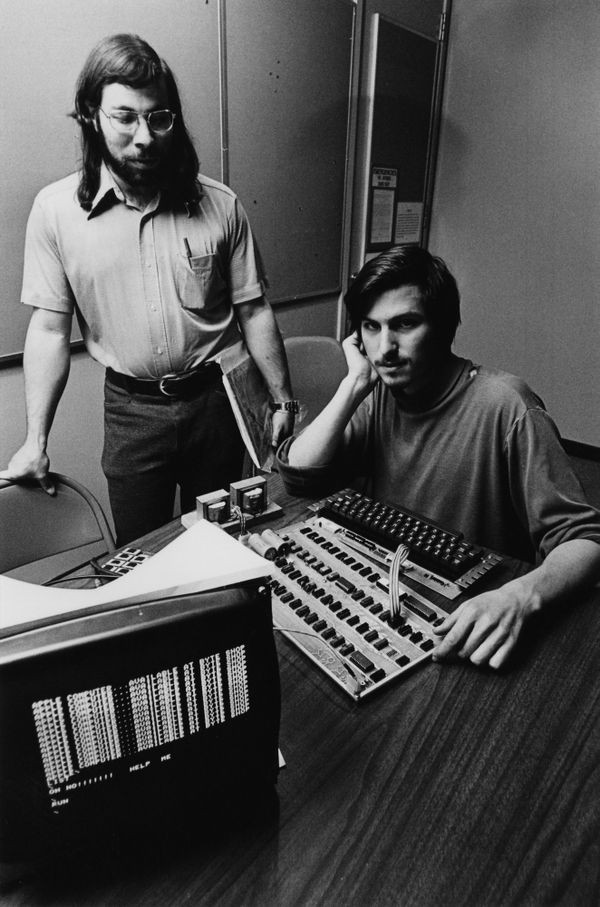
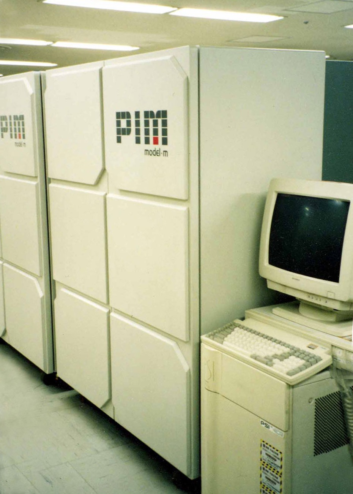

<!-- Section 1: Tujuan Pembelaran -->

  <h3 class="text-indigo-800 m-0 mb-3 flex items-center gap-2">🎯 Tujuan Pembelajaran</h3>
  <ul class="text-indigo-900 m-0 text-sm">
    <li>Murid mampu menelaah sejarah komputer dari generasi pertama sampai kelima, lengkap dengan tokoh dan cirinya.</li>
  </ul>
   
  
<strong>🔑 Kata kunci:</strong> Generasi Komputer · Revolusi Industri 4.0 · Dampak Teknologi

<!-- Section 2: Materi Pembelaran -->

---

## 🗺️ Peta Belajar

| Modul | Topik | Aktivitas |
|---|---|---|
| 1 | Sejarah Komputer dan Tokohnya | Ayo Berlatih (individu) + Ayo Berdiskusi (kelompok) |
| 2 | Revolusi Industri 4.0 | Ayo Berdiskusi (kelompok) |
| 3 | Dampak Perkembangan Teknologi | Ayo Berlatih (individu) |
| 4 | Kuis Cepat & Refleksi | Mandiri |

---

## 💭 Pemantik

Sebelum mulai, coba renungkan:

- Amati komputer di sekolah atau di rumahmu. Pernahkah kamu membayangkan suatu hari komputer itu ditinggalkan karena ada teknologi baru yang lebih canggih?
- Lihat bengkel atau laboratorium praktik di kompetensi keahlianmu. Adakah komputer di sana? Alat apa saja yang kini dioperasikan dengan komputer?
- Menurutmu, faktor apa yang membuat sebuah perusahaan memutuskan mengganti seluruh perangkat komputernya?

---

# Modul 1 — Sejarah Komputer dan Tokohnya

Komputer ada di hampir semua bidang keahlian SMK: untuk mengolah data dan informasi, untuk berkomunikasi, bahkan untuk mengoperasikan alat praktik digital. Padahal dulu komputer hanyalah alat bantu hitung berukuran besar dengan kapasitas penyimpanan yang sangat kecil.

> 💡 **Tahukah kamu?** Awal mula komputer dimulai dari mesin hitung bernama **Difference Machine** karya **Charles Babbage** (1822). Karena jasanya, Babbage dijuluki **Bapak Komputer Dunia**.

## ⏱️ Garis Waktu Lima Generasi Komputer

| Generasi | Periode | Teknologi kunci | Tokoh / produk | Ciri utama |
|---|---|---|---|---|
| **1** | 1940–1959 | Tabung hampa | Babbage, Hollerith, Turing, Zuse, Mauchly (ENIAC) | Bahasa mesin, ukuran dan kebutuhan listrik besar, lambat, penyimpanan sangat kecil |
| **2** | 1959–1965 | Transistor | Shockley, Bardeen, Brattain | Bahasa Assembly, memori lebih besar, magnetic disk, proses real-time |
| **3** | 1965–1970 | Integrated Circuit (IC) | Jack Kilby, Xerox Alto | Komputer pribadi, ukuran lebih kecil, mouse + keyboard + monitor, disket |
| **4** | 1970–1980 | VLSI, microprocessor | Steve Jobs & Steve Wozniak (Apple I), Intel | COBOL/BASIC/Pascal, mengenal DBMS |
| **5** | Masa kini | VLSI + kecerdasan buatan | Apple (MacBook, iPhone) | AI, sistem operasi GUI, smartphone, tablet, notebook |

## 1️⃣ Generasi Pertama: Era Tabung Hampa

**Perjalanan menuju komputer pertama:**

- **1822 — Charles Babbage** merancang *Difference Machine* untuk memecahkan masalah dan menganalisis persamaan matematika.
- **1890 — Herman Hollerith** merancang sistem kartu yang mampu menghitung sensus di Amerika Serikat. Inilah cikal bakal berdirinya perusahaan **IBM**.
- **1930 — Alan Turing** mengembangkan cikal bakal komputer digital pertama, *Turing Machine*, yang mampu menjalankan sekumpulan perintah.
- **1936 — Konrad Zuse**, insinyur mesin asal Jerman, membuat komputer digital **Z1** dari rakitan pelat logam dan pin, yang bisa menambah dan mengurangi.
- **1943 — John Mauchly** menciptakan **ENIAC** (*Electronic Numerical Integrator and Calculator*), yang sanggup menghitung ribuan masalah dalam satu detik.

> 💡 **Fakta ENIAC:** beratnya mencapai **30 ton** dan membutuhkan ruangan yang sangat luas.

**Ciri generasi pertama:** menggunakan **tabung hampa**, diprogram dengan **bahasa mesin**, ukuran fisik dan kebutuhan daya listrik sangat besar, proses relatif lambat, dan kapasitas penyimpanan sangat kecil.

*Dari kiri: Penemu J. Presper Eckert dan John W. Mauchly sedang bekerja dengan ENIAC. Bettmann/Getty Images*

## 2️⃣ Generasi Kedua: Era Transistor

**Tokoh:** William Bradford Shockley, John Bardeen, dan Walter Houser Brattain, penemu cikal bakal komputer generasi kedua.

**Ciri-ciri:**

- Tidak lagi memakai tabung hampa, tetapi **transistor**.
- Bahasa pemrograman: **Assembly**.
- Memori lebih besar daripada generasi pertama.
- Penyimpanan berupa **magnetic disk**.
- Proses cukup cepat sehingga dapat dikatakan **real-time**.
- Periode: **1959–1965**.

*IBM 1620 salah satu komputer di era transistor | IMLS Digital Collections and Content*

## 3️⃣ Generasi Ketiga: Era Integrated Circuit

**Tokoh:** **Jack Kilby**, insinyur Texas Instruments, mengembangkan **IC (Integrated Circuits)**, gabungan tiga komponen elektronika: **transistor, kapasitor, dan resistor**.

**Ciri-ciri (1965–1970):**

- Muncul masa **komputer pribadi (personal computer)**.
- Ukuran fisik lebih kecil karena memakai hybrid integrated circuits.
- Mampu **multiprocessing**, **multiprogramming**, dan **komunikasi data**.
- Perangkat input-output berbasis visual: **mouse, keyboard, dan monitor**.
- Media penyimpanan **floppy disk (disket)** berkapasitas **1,44 MB**.

> 💡 **Tahukah kamu?** **Xerox Alto** (1970) adalah komputer pertama yang bisa mengirim email dan mencetak dokumen. Tampilannya sudah menyerupai komputer modern.

*Komputer Xerox Alto II XM. Perhatikan bahwa layar videonya diatur dalam mode potrait. Di samping papan ketik terdapat sebuah tetikus (mouse). Unit diska Diablo terletak di bawah papan ketik. Bagian dasar perangkat ini memuat papan sirkuit dan power supply.*

## 4️⃣ Generasi Keempat: Era VLSI dan Apple

**Periode:** 1970–1980

- **1976:** Apple, didirikan oleh **Steve Jobs dan Steve Wozniak**, meluncurkan produk pertamanya, **Apple I**, komputer dengan satu *single circuit*.
- Menggunakan **VLSI (Very Large Scale Integration)**: ratusan ribu IC dipadatkan dalam satu chip.
- Bahasa pemrograman: **COBOL, BASIC, dan Pascal**.
- Mulai mengenal **DBMS (Data Base Management System)**.
- Jobs dan Wozniak mengembangkan **microprocessor** yang ditanam dalam board komputer. Selain Apple, Intel mengembangkan komputer **Pentium II**.

*Steve Jobs dan Steve Wozniak dengan komputer Apple-1*

## 5️⃣ Generasi Kelima: Era Kecerdasan Buatan

Perkembangan generasi ini lebih menekankan **kemampuan komputer menyelesaikan masalah**.

**Ciri-ciri:**

- Tetap memakai **VLSI**, tetapi mampu memproses data dengan **Artificial Intelligence (AI)**.
- Sistem operasi berbasis **GUI (Graphical User Interface)**.
- Lahirnya **smartphone, tablet, dan notebook**.
- Orientasi utama: teknik dan bisnis. Memori besar, mesin tidak cepat panas, proses cepat, hemat daya listrik.

**Produk:** MacBook Pro (2006), MacBook Air (2007), iPhone (2010).

> 🤖 **AI di genggamanmu:** membuka kunci perangkat dengan **sidik jari** atau **pengenalan wajah** adalah contoh kecerdasan buatan pada sistem.

*Komputer Generasi Kelima merupakan inisiatif 10 tahun yang diluncurkan pada tahun 1982 oleh Kementerian Perdagangan Internasional dan Industri (MITI) Jepang untuk mengembangkan komputer berbasis komputasi paralel masif dan pemrograman logika. Proyek ini bertujuan menciptakan "komputer yang membawa perubahan besar" dengan kinerja setara superkomputer, sekaligus membangun landasan bagi kemajuan kecerdasan buatan (AI) di masa depan.*

---

# Modul 2 — Revolusi Industri 4.0

Perkembangan komputer mengubah banyak bidang. Sektor industri mulai beralih ke **otomatisasi dan digitalisasi**. Di bengkel, laboratorium, atau workshop sekolahmu, alat praktik yang dulu manual kini banyak yang dioperasikan dengan komputer.

**Revolusi Industri 4.0** adalah kolaborasi antara teknologi informasi dan komunikasi di bidang industri. Fokusnya adalah **kecepatan, ketersediaan informasi, dan kemudahan berbagi informasi**. Dengan memahaminya, kamu bisa memanfaatkan teknologi untuk menyelesaikan tugas dan pekerjaan, sekarang maupun nanti.

## 🧩 Delapan Penerapan Revolusi Industri 4.0

| Bidang | Apa itu? | Contoh manfaat |
|---|---|---|
| **IoT** (Internet of Things) | Objek yang ditanami software dan sensor agar bisa berkomunikasi, mengendalikan, dan terhubung dengan perangkat lain. | Elektronika: pengendali peralatan listrik dan sensor pengatur daya listrik. |
| **Big Data** | Kumpulan data besar yang terus bertambah (terstruktur maupun tidak) sebagai sumber pengambilan keputusan. | Pendaftaran siswa baru: sekolah menarik data induk dari SD dan SMP lewat input NISN. |
| **AI** (Artificial Intelligence) | Pengetahuan yang ditanamkan pada mesin agar punya kecerdasan seperti manusia dan bisa belajar dari data. | *Voice assistant* di smartphone, misalnya mencari di Google dengan suara. |
| **Cyber Security** | Upaya melindungi data, perangkat, dan jaringan dari kejahatan siber dan akses ilegal (application, network, information, cloud, operational security, disaster recovery planning, end-user education). | Verifikasi nomor HP saat login Gmail dari perangkat lain. |
| **AR** (Augmented Reality) | Penggabungan objek virtual 2D/3D dengan dunia nyata sehingga tampak menyatu. | Produk praktik Multimedia: objek 3D dibuat dengan 3Ds Max, Blender, atau Maya, misalnya untuk game anak. |
| **Cloud Computing** | Layanan lewat internet berupa SaaS, PaaS, dan IaaS, sehingga bisa dipakai kapan saja dan di mana saja tanpa instalasi. | Google Drive sebagai penyimpanan non-fisik. |
| **Additive Manufacturing** | Proses produksi dengan menambahkan lapisan 3D untuk menghasilkan barang jadi, menekankan efektivitas dan kecepatan (*direct manufacturing* dan *rapid prototyping*). | Teknik Fabrikasi Logam dan Manufaktur: printer 3D untuk membuat objek atau sparepart. |
| **Integrated System** | Penggabungan sistem komputer dan software yang terhubung secara fisik dan fungsional. | Pembuatan SIM: sidik jari dan tanda tangan dipindai, data masuk ke komputer, lalu dicetak jadi kartu. |

---

# Modul 3 — Dampak Perkembangan Teknologi

Teknologi yang berkembang akan menambah keterampilan yang kamu butuhkan karena peralatan praktik di sekolah ikut naik kelas. Contohnya di **Teknik Permesinan**: dulu siswa memakai mesin manual, sekarang **CNC (Computer Numerical Control)** wajib dipelajari.

Setiap kemajuan teknologi pasti berdampak pada kehidupan sosial. Berikut sebagian kecil dampaknya; kamu bisa menambahkan dari hasil pengamatanmu sendiri di masyarakat.

## ✅ Dampak Positif

1. **Kemudahan mengakses informasi.** Informasi bisa diakses di mana pun dan kapan pun, dan perangkat canggih membantu kita *memvalidasi kebenaran* informasi tersebut.
2. **Efektivitas kegiatan produksi.** Produksi barang maupun jasa yang dibantu komputer menghasilkan lebih banyak. Contoh produksi jasa: pembuatan media promosi. Promosi online terbukti lebih menarik pelanggan daripada promosi offline karena jual beli kini banyak dilakukan online.
3. **Peluang kerja makin luas.** Salah satunya **content creator**: pembuat teks, gambar, video, animasi, atau media interaktif yang bernilai jual (pendidikan, kesehatan, hiburan). Dulu ini lahan profesional, kini terbuka untuk semua kalangan, termasuk siswa SMK/MAK. Di era 4.0, peluang justru lebih banyak untuk **berwirausaha** di industri kreatif.

## ⚠️ Dampak Negatif

1. **Lebih rentan terhadap kejahatan siber.** *Cyber crime* adalah kejahatan yang memakai komputer sebagai alat. Jaringan yang menghubungkan perangkat memudahkan komunikasi, tetapi juga membuat pertukaran informasi penting dan transfer uang menjadi sasaran empuk. Pelakunya sering disebut **hacker** dan **cracker**, dua istilah yang mirip tetapi artinya berbeda:

   | | 🧑‍💻 Hacker | 🦹 Cracker |
   |---|---|---|
   | Tujuan | Ingin tahu cara kerja sistem secara mendalam | Masuk ke sistem orang lain dengan niat merusak atau mencari keuntungan |
   | Sikap pada celah sistem | Mencari kelemahan tanpa merusak, lalu melaporkannya ke perancang sistem agar diperbaiki | Memanfaatkan kelemahan untuk membobol sistem, misalnya login memakai username dan password orang lain |
   | Ilmu | Mau berbagi ilmu, dipakai untuk belajar, bukan mengganggu | Memakai kemampuan, termasuk alamat IP yang sulit dilacak, untuk membobol situs dan mencuri uang lewat internet banking |
   | Contoh tindakan | — | *Phishing*, *malware*, peretasan dan spamming media sosial, *cyber bullying* |

2. **Membutuhkan biaya investasi besar.** Perusahaan harus meremajakan alat, membeli banyak komputer sekaligus, dan menyediakan sumber daya manusia yang mampu mengoperasikan teknologi, termasuk pelatihan bagi karyawan tetap.
3. **Sampah elektronik merusak lingkungan.** Komponen komputer punya umur dan akhirnya dibuang. Sampah elektronik tergolong **B3 (bahan beracun dan berbahaya)** karena mengandung merkuri, timbal, kromium, PVC, dan lainnya. Produksi elektronik jauh lebih banyak daripada kemampuan pengelolaan sampahnya.

> 🛡️ **Waspada!** Salah satu kasus yang marak adalah pembobolan rekening lewat transaksi internet banking. Hati-hati saat bertransaksi online, terutama yang menyangkut data, informasi, dan perbankan.

---

## 📌 Yang Perlu Diingat

- Komputer berkembang dari mesin hitung raksasa (tabung hampa) menjadi perangkat yang bisa kamu bawa di saku (AI, smartphone).
- Lima generasi komputer ditandai oleh teknologi kuncinya: tabung hampa → transistor → IC → VLSI → AI.
- Revolusi Industri 4.0 menekankan kecepatan, ketersediaan, dan kemudahan berbagi informasi.
- Teknologi membawa peluang (akses informasi, efektivitas produksi, peluang kerja) sekaligus risiko (kejahatan siber, biaya besar, sampah elektronik).

---

<!-- Section 3: Referensi -->

    <h4 class="text-slate-800 m-0 mb-2 flex items-center gap-2">📚 Referensi</h4>
    
<em>Materi ini merupakan tulisan ulang dari sub-bab "Sejarah Teknologi Informasi" (Bab 2 – Dampak Sosial Informatika) pada buku Informatika untuk SMK/MAK Kelas X Semester 2 karya Kusmadi, dengan catatan relevansi tren industri terkini di Indonesia (per September 2026).</em>

